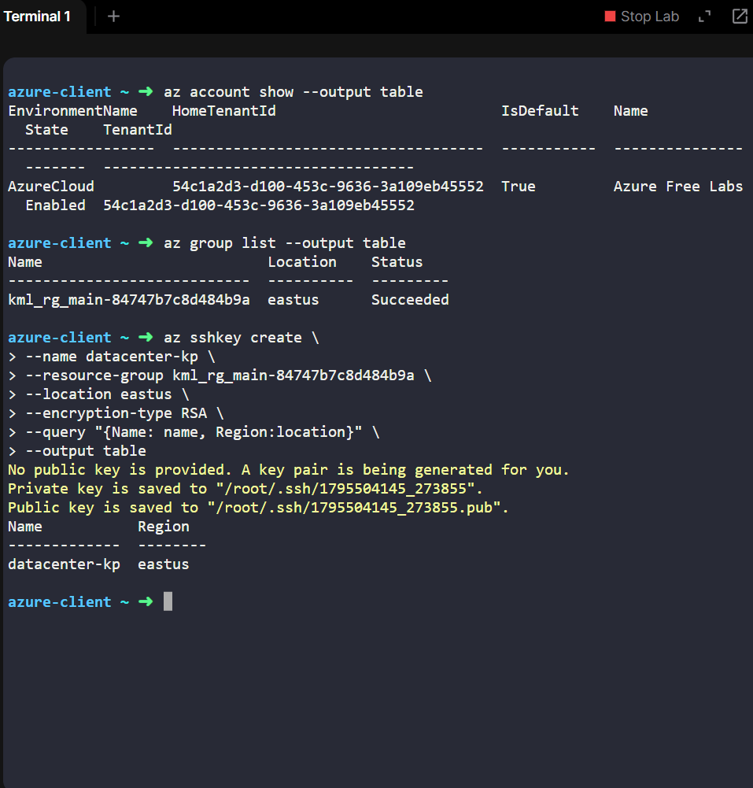

# Day 01: Creating an RSA SSH Key Pair in Azure

**Challenge:** 100 Days of Azure Cloud Engineering  
**Platform:** Microsoft Azure  
**Tools:** Azure CLI, Linux Terminal  
**Status:** SSH Key Created Successfully

## 1. Project Overview

This lab is part of a simulated cloud migration project for the fictional Nautilus DevOps team.

The organization is preparing to migrate portions of its infrastructure to Microsoft Azure. Rather than migrating everything simultaneously, the team is dividing the process into smaller, manageable tasks.

This incremental approach can reduce operational risks, simplify troubleshooting, and make it easier to verify each infrastructure component before proceeding.

My first task was to create an SSH key pair that could support secure authentication to Linux virtual machines in Azure.

### Task Requirements

- **SSH Key Name:** `datacenter-kp`
- **Key Algorithm:** RSA
- **Cloud Provider:** Microsoft Azure
- **Region Used:** East US

## 2. Understanding SSH Key Authentication

SSH (Secure Shell) is a protocol that enables secure remote access to computers and servers.

SSH key authentication uses two cryptographically related keys:

- **Public Key:** Can be registered on a remote server and is used to verify authentication.
- **Private Key:** Must remain confidential and is used to prove that the connecting user possesses the matching key.

The RSA algorithm was required for this task.

In real-world cloud environments, SSH authentication is commonly used when engineers administer Linux servers remotely.

## 3. Implementation Steps

### Step 1: Verify the Azure Subscription

I started by checking the active Azure subscription.

```bash
az account show --output table
```

**Why I performed this step:**

Before creating infrastructure, it is important to verify which Azure subscription is currently active.

In an organization, engineers may work across development, testing, staging, and production environments.

Deploying resources into the wrong subscription can cause unnecessary costs, security issues, or operational disruptions.

**Result:** I confirmed that the `Azure Free Labs` subscription was enabled.

### Step 2: Identify the Azure Resource Group

Next, I ran:

```bash
az group list --output table
```

**Why I performed this step:**

Azure resource groups provide a logical way to organize and manage related cloud resources.

Before creating the SSH key resource, I needed to identify the resource group provided for the lab.

**Result:** I identified an existing resource group located in the `eastus` region.

### Step 3: Create the SSH Key Pair

After identifying the resource group, I executed the following Azure CLI command:

```bash
az sshkey create \
  --name datacenter-kp \
  --resource-group <lab-resource-group> \
  --location eastus \
  --encryption-type RSA \
  --query "{Name:name, Region:location}" \
  --output table
```

*The resource group is shown as a placeholder in this public documentation.*

**Why I performed this step:**

Creating an SSH key pair is one way to prepare secure authentication for Linux infrastructure hosted in Azure.

The `--encryption-type RSA` argument explicitly specifies the algorithm required by the task.

**Result:**

Azure CLI reported that a new key pair was generated and saved the corresponding public and private key files on the lab host.

The command returned:

```text
Name           Region
-------------  ------
datacenter-kp  eastus
```

This confirmed that the Azure SSH public key resource creation command succeeded.

## 4. Real-World Relevance

This task represents one small security-related activity within a larger cloud migration.

In a company, cloud engineers and DevOps teams may be responsible for:

- Preparing Azure environments before workload migration.
- Managing identities and secure server access.
- Provisioning Linux virtual machines.
- Organizing infrastructure into resource groups.
- Automating infrastructure deployment.
- Verifying changes before proceeding to the next migration phase.

For example, when a company migrates a Linux-based application from an on-premises data center to Azure, engineers may need to configure authentication for authorized administrators.

SSH keys can form part of that access strategy.

However, creating an SSH public key resource alone does not grant access to a server. The public key must also be configured for an appropriate user on the target system.

In production, organizations must additionally protect private keys, enforce access policies, monitor activities, and manage credentials throughout their lifecycle.

## 5. What I Learned

Through this exercise, I learned:

1. How to inspect an active Azure subscription using Azure CLI.
2. How to identify existing Azure resource groups.
3. How to create an Azure SSH public key resource using RSA.
4. The difference between public and private SSH keys.
5. Why authentication and credential security matter in cloud environments.
6. Why cloud infrastructure changes should be implemented and verified incrementally.

## 6. Challenges and Troubleshooting

No errors were encountered during the creation command.

The next step is to independently verify that the resource exists and that its public key uses RSA.

## 7. Evidence



The screenshot documents environment discovery, execution of the SSH key creation command, and Azure's successful response.

## 8. Key Takeaway

This exercise introduced me to Azure CLI and a foundational cloud security task.

It also helped me understand how a larger infrastructure migration can be broken into smaller, independently verifiable steps.

Although this lab involved creating just one resource, the underlying practices of environment discovery, secure authentication, careful execution, and verification are relevant to cloud engineering and DevOps work.